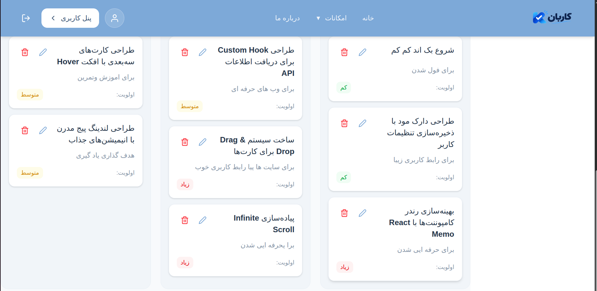
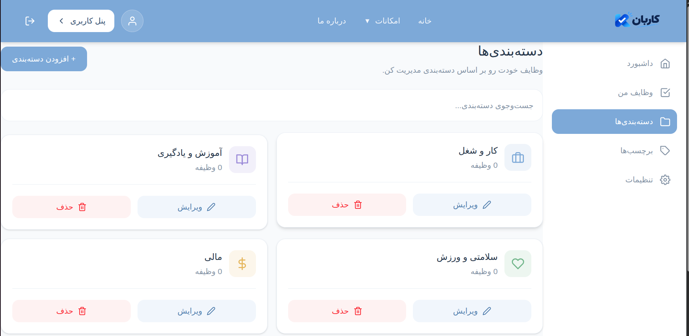
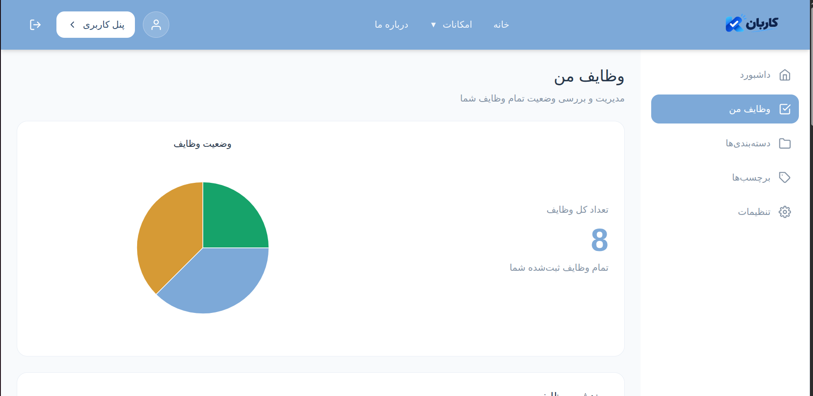

# Karban – Task Management App

A modern and responsive task management application built with React, TypeScript, and Supabase.

Karban helps users organize their daily tasks, manage categories and tags, track progress, and stay focused on their goals through a clean and user-friendly interface.

## 🚀 Live Demo

[View Karban](https://safaeii.github.io/karban-task-manager-app/)

## 📸 Screenshots

### Landing Page


### Task Management


### Statistics & Reports


## ✨ Features

- **User Authentication:** Sign up and sign in functionality.
- **Dashboard:** Overview of tasks and daily progress.
- **Task Management:** Create and manage tasks.
- **Categories:** Organize tasks into different categories.
- **Tags:** Label and organize tasks.
- **Statistics & Reports:** Track task progress and productivity.
- **Settings:** Manage application preferences.
- **Responsive Design:** Optimized for desktop, tablet, and mobile devices.
- **Modern UI:** Clean interface with smooth animations.

## 🛠️ Tech Stack

| Technology | Purpose |
|---|---|
| React | UI development |
| TypeScript | Type safety |
| Vite | Development and build tool |
| Tailwind CSS | Styling |
| React Router | Routing |
| Supabase | Backend and authentication |
| Framer Motion | Animations |
| Recharts | Data visualization |
| dnd-kit | Drag and drop interactions |
| React Icons | Icons |

## 📁 Project Structure

```text
src/
├── components/
├── features/
│   ├── auth/
│   ├── dashboard/
│   ├── tasks/
│   ├── categories/
│   ├── tags/
│   ├── settings/
│   ├── about/
│   └── landing/
├── layouts/
├── routes/
└── main.tsx

public/
└── images/
```

## ⚙️ Installation & Setup

Clone the repository:

```bash
git clone https://github.com/Safaeii/karban-task-manager-app.git
```

Navigate to the project directory:

```bash
cd karban-task-manager-app
```

Install dependencies:

```bash
npm install
```

Configure your Supabase environment variables in a `.env` file according to the application's Supabase configuration.

Start the development server:

```bash
npm run dev
```

## 📦 Build

To create a production build:

```bash
npm run build
```

To preview the production build locally:

```bash
npm run preview
```

## 🚀 Deployment

Karban is deployed using GitHub Pages.

```bash
npm run deploy
```

## 👩‍💻 Author

**Elahe Safaeii**

Frontend Developer

- GitHub: [@Safaeii](https://github.com/Safaeii)